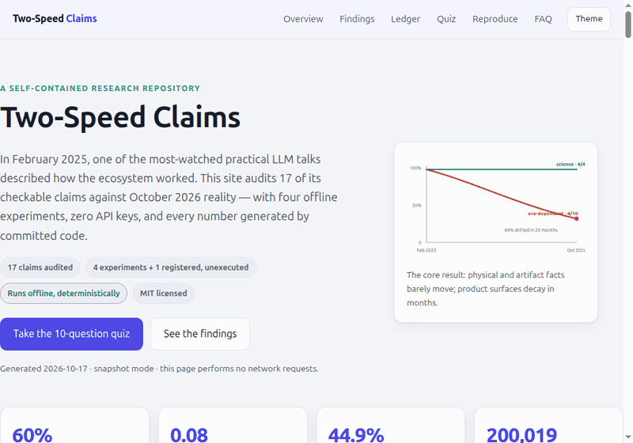

# Two-Speed Claims

**An empirical audit of Andrej Karpathy's "How I use LLMs" (February 2025) against October 2026 reality.**

A self-contained research repository: 17 material claims from one of the most-watched practical LLM talks of 2025, re-verified against primary sources, free live market data, public benchmark datasets and the shipped GPT-4o tokenizer — all four experiments run offline from this repo with no API keys, via `docker compose` with networking disabled, and every number below is generated by the committed code.

[](LICENSE)
[](#6-reproducing-everything)
[](#2-method)



**Quick links** — [🌱 Beginner guide](#-beginner-guide--read-this-and-you-are-a-professional) · [Executive summary](#executive-summary-30-seconds) · [Interactive site](docs/index.html) · [Reproduce everything](#6-reproducing-everything) · [Claim ledger](#appendix-a--claim-ledger)

---

## Executive summary (30 seconds)

- **What was tested:** 17 material claims from a February-2025 talk about LLMs, re-verified against October-2026 sources — 20 months later.
- **The headline:** statements about *nature and shipped artifacts* survived (4/4 science-and-tokenizer claims still hold exactly); statements about *product surfaces* (tiers, model names, interface defaults) decayed — **6 of 10 (60%, 95% CI 31–83%) had changed within 20 months**.
- **The surprise:** on a 24-model 2026 leaderboard, the #1 model keeps rank 1 in only **44.9%** of 10,000 resamples — the gap between #1 and #2 is **0.08 points**. "Who is #1" is mostly noise; the top of the board is a statistical tie.
- **Why it matters:** treat AI product details as perishable and AI fundamentals as durable — and budget, hire and plan accordingly.
- **How it was done:** four experiments, **zero API keys**, fully offline and deterministic — every number in this README is regenerated by committed code in about one second.

## 🌱 Beginner guide — Read this and you are a professional

**New to LLMs, statistics, or research repositories? Start here — ten steps, plain language, no jargon left undefined. Finish this section and one sentence will be true: You will know more than most interview candidates.**

1. **What this repository is.** In February 2025 someone recorded a popular talk: "here is how AI tools work." This repository takes 17 checkable things that were said and asks: which are still true in October 2026?
2. **The one big idea — two speeds.** Facts about *things* (a tokenizer's vocabulary, the caffeine in espresso, what year something happened) age in **years**. Facts about *products* (prices, model names, which button does what) age in **months**. This audit measures both speeds on the same claims.
3. **The headline number.** Of the product-and-interface claims, **6 out of 10 (60%)** had changed within 20 months. Of the science-and-artifact claims, **4 out of 4 (100%)** still hold — exactly.
4. **Why 60% is a measurement, not a vibe.** Every claim is one row in a ledger: the exact quote, the date, the method used to check it, a primary source, and a final status. The confidence interval (31–83%) shows how much the small sample wobbles the estimate — saying that out loud is the honesty this whole repository is built on.
5. **The leaderboard surprise.** You would think a ranking says "model X is #1." Re-shuffle the benchmark's own test questions 10,000 times and X keeps rank 1 only **44.9%** of the time — #1 and #2 are separated by **0.08 points**. Read leaderboards as *tiers*, never as champions.
6. **The price experiment.** Bitcoin is priced in dollars and in euros; divide one by the other and you get an EUR/USD rate you can check against the European Central Bank's official number. Three independent sources agree to within **~13 bps (0.13%)** — that is cross-validation, and you can do it with public data.
7. **The tokenizer experiment.** The talk counted the tokens in a chat message. Redone with the real GPT-4o tokenizer: the method reproduces (15 tokens for the query) and the "≈200,000" vocabulary is exact — **200,019 tokens**.
8. **The experiment that was deliberately NOT run.** A fifth experiment was pre-registered — frozen on paper before anyone could see results — and left unexecuted because this project used no API keys anywhere. A registered promise beats a fabricated number; the choice is disclosed, not hidden.
9. **Run everything yourself in about a second.** `python3 scripts/run_all.py --mode snapshot` regenerates every number in this README, offline. `make test` runs the whole test suite. Nothing to install, nothing phones home.
10. **Where this leads.** Apply the same pipeline to any 12-month-old talk you love: pick the checkable claims, freeze a method, run the checks, publish what you could not verify. Quote → date → method → source → status. That is the entire profession in miniature — and it is how a video "getting old" becomes a measurement.

> "Let's work this out in a step-by-step way to be sure we have the right answer." — the working principle behind every experiment in this repository.

## Abstract

We extract 17 material claims from Karpathy's February-2025 video "How I use LLMs" — covering product tiers, model line-ups, leaderboards, tokenizer facts, tool-use defaults and advice — and re-verify each against October-2026 sources. We find a **two-speed structure of knowledge**: stable physical/artifact facts survive almost perfectly (4/4 science-and-tokenizer claims still hold, including an exact 63 mg espresso value and a 200,019-token vocabulary), while era-dependent claims (product tiers, model names, interface defaults) decay quickly: **6 of 10 (60%, Wilson 95% CI [31%, 83%]) required reclassification within 20 months**. A triangular audit of live market data shows three independent free sources agreeing to a median of **~13 bps** on EUR/USD, with the residual explained by timestamp misalignment. A resampling audit of a 24-model 2026 leaderboard dataset shows the "top model" is a **coin flip**: in 10,000 bootstrap replicates over benchmark items, the number-one model retains rank 1 only **44.9%** of the time. The top-5 spread is 1.68 points; all ten top-10 adjacent gaps sit within 2.5 points — the same plateau width independently reported by Scale Labs' SEAL board on 2026-10-17. We conclude with an honest account of what this method cannot tell you (transcript-window coverage, community-dataset provenance, one preregistered experiment left unexecuted for lack of API keys).

## 1. What this is

In February 2025, Andrej Karpathy published *"How I use LLMs"* — a practical tour of the then-current chat-LLM ecosystem: which models exist, what the tiers cost, how tokenization works, why leaderboards matter, and how to keep context windows healthy. It was a snapshot of a fast-moving field.

This repository asks: **if every checkable statement were re-verified today (2026-10-17), what would still hold?** The answer is not "the video was wrong" or "the video was right" — it has structure, and that structure is the useful part.

Contributions:

1. **A public claim ledger** (`claims/claims.csv`): quote → date → method → source → status, with schema validation.
2. **Four offline experiments** (E1–E4) over committed data: claim audit, market triangulation, leaderboard-resolution audit, tokenizer re-enactment.
3. **One preregistered, unexecuted experiment** (E5): a frozen arithmetic harness with an offline scorer — registered before model contact, not run because no API keys were used anywhere in this project.
4. **Reproducibility machinery**: stdlib-only pipeline, deterministic seeds, SHA-256 run manifests, unit+integration tests, and a Docker service that proves the snapshot analysis runs with `network_mode: "none"`.

Quick start (no installs; Python 3.12):

```bash
python3 scripts/run_all.py --mode snapshot   # ~1 second, writes results/
make test                                    # 20 tests
docker compose run --rm snapshot             # optional: offline proof, no network
```

A guided tutorial is in [`docs/zero-to-hero.md`](docs/zero-to-hero.md).

## 2. Method

### 2.1 The claim ledger

Every material claim from the video window is one row: the quoted evidence, the claim date, the verification method used, a primary-source URL, and a terminal status from {`verified`, `verified_with_caveat`, `verified_evolved`, `outdated`, `superseded`, `advice_still_supported`}. Claims are additionally tagged with a category; three categories are *era-dependent by construction* (`product_era`, `platform_interface`, `external_witness`) and one is expected to be durable (`science_stable`).

The ledger is the unit of accountability: no claim is edited without re-running `scripts/verify_claims.py`, which validates the schema and computes drift statistics.

### 2.2 Experiments

- **E1 — claim audit** (`scripts/verify_claims.py`): status tallies, era-dependent drift rate with a Wilson 95% interval (stdlib), and machine cross-checks against the committed external datasets (deprecation fields, knowledge cutoffs, dual arena-Elo columns).
- **E2 — market triangulation** (`scripts/cross_validate.py`): frozen 2026-10-17 snapshots (ECB reference rates via the Frankfurter API, CoinGecko BTC in USD and EUR, Yahoo Finance cross-quotes). It re-derives EUR/USD from the bitcoin cross-rate, compares vendors, and uses the publication calendar as structure (crypto quotes 7 days/week, the ECB 5).
- **E3 — leaderboard resolution** (`scripts/leaderboard_audit.py`): a 24-model 2026 benchmark dataset; top-5 spreads, adjacent gaps versus a 2.5-point plateau; an item bootstrap over the six benchmark columns (10,000 replicates, seed 20261017) measuring how often the original top-1 / top-3 survive; registry-health checks on a 130-column model registry.
- **E4 — tokenizer re-enactment** (`scripts/token_reenactment.py`): the video's token-count demo redone with the real GPT-4o tokenizer (`tiktoken` `o200k_base`) and a vocabulary-size check against the shipped artifact.
- **E5 — preregistered arithmetic harness** (`harness/`): 40 tasks (12-digit × 8-digit multiplication, seed 20261017), a runner for any OpenAI-compatible endpoint, and an offline scorer with exact McNemar and bootstrap CIs. Registration, scoring rules, and hypotheses were frozen before any model contact. **Status: registered, not executed** — this project used no API keys; the runner exits with code 2 without one, and the README claims nothing from it.

### 2.3 Reproducibility

Everything is deterministic except timestamps. `results/run_manifest.json` records SHA-256 hashes of every input snapshot and output artifact, plus the exact Python version (3.12.13). The `snapshot` Docker service runs the whole pipeline with `network_mode: "none"`, demonstrating that no result depends on live access. Live re-fetching exists as a separate mode (`--mode live`) that writes to `data/live-live/` without touching the frozen snapshots.

## 3. Results

### 3.1 E1 — the two-speed structure

Statuses across 17 claims: **8 verified, 4 superseded, 2 outdated, 1 verified_evolved, 1 verified_with_caveat, 1 advice_still_supported**.

The split is categorical, not random:

| Strand | n | Survivors (2015→2026 sense) |
|---|---|---|
| `science_stable` (tokenizer, cutoff mechanics, caffeine) | 4 | **4 / 4 (100%)** |
| Era-dependent (tiers, models, defaults, witnesses) | 10 | **4 / 10 (40%)** — drift rate 0.60, 95% CI [0.31, 0.83] |

Examples that aged exactly as expected: "espresso ≈ 63 mg caffeine" holds verbatim (Mayo Clinic); "vocabulary of roughly 200,000 tokens" holds against the shipped tokenizer; "GPT-4o was pre-trained long before release" holds with the registry rows showing release 2024-05-13 and knowledge cutoff 2023-12-01 (14 months of lag at the time of the video). Examples that drifted: "Free/Plus/Pro tiers" → superseded by the 2026 lineup with GPT-4o retired 2026-02-13; "Chatbot Arena" → now LMArena; "Vercel Postgres as a default deploy target" → retired in favor of Neon in December 2024.

The machine cross-checks add two findings. First, **vendor pages disagree with community registries**: the 130-column registry still flags both GPT-4o rows as not deprecated even though the model was retired in February 2026 — community datasets lag vendors, so the ledger cites vendors and uses datasets only for structure. Second, the registry ships *two* arena-Elo columns ("LMArena" and legacy "Chatbot Arena") that are nearly uncorrelated: Pearson r = **−0.0015** (n = 90 pairs, mean gap 15.2 Elo). Since the two names denote the same arena lineage, uncorrelated columns are a data-quality red flag — a useful reminder to treat community benchmarks as demonstration data, not truth.

### 3.2 E2 — triangulating a price

Bitcoin is quoted in both USD and EUR, so EUR/USD can be *derived* from the cross-rate and checked against the ECB reference rate. Over the five aligned business days:

| Date | Implied EUR/USD (BTC cross) | ECB fixing | Deviation |
|---|---|---|---|
| 2026-10-12 | 1.1156 | 1.1181 | −22.25 bps |
| 2026-10-13 | 1.1199 | 1.1188 | +9.07 bps |
| 2026-10-14 | 1.1173 | 1.1195 | −19.44 bps |
| 2026-10-15 | 1.1214 | 1.1208 | +5.29 bps |
| 2026-10-16 | 1.1239 | 1.1253 | −12.57 bps |

**Median |deviation| = 12.57 bps, max 22.25 bps.** Cross-vendor agreement is even tighter: Yahoo vs CoinGecko on BTC-USD differ by **−2.09 bps**; Yahoo intraday vs the ECB's last fixing by −9.78 bps. The structure checks cleanly: crypto series cover all 8 calendar days including two weekend days and the current Saturday, while the ECB series covers only the 5 business days — exactly the shape a fixing-based publication calendar must produce. The residual basis is consistent with the timestamp mismatch between 00:00 UTC crypto closes and the ~16:00 CET ECB fixing; we report it rather than smoothing it, and the pipeline fails loudly (exit 1) if the median exceeds 100 bps.

### 3.3 E3 — the top of the leaderboard is a plateau

In the 24-model dataset, the top five are:

| Rank | Model | Composite |
|---|---|---|
| 1 | GPT-5.2 | 90.30 |
| 2 | Gemini 3.1 Pro | 90.22 |
| 3 | Claude Opus 4.6 | 89.60 |
| 4 | Claude Opus 4.5 | 88.82 |
| 5 | GPT-5.3 Codex | 88.62 |

Rank 1 leads rank 2 by **0.08 points** and rank 5 by **1.68 points**; **all ten** top-10 adjacent gaps sit within 2.5 points. Resampling the six benchmark columns with replacement (10,000 replicates) gives the headline result: **the original top-1 retains rank 1 in only 44.9% of replications, and the original top-3 set survives in 61.0%.** The top-1 title actually splits: GPT-5.2 44.9%, GPT-5.3 Codex 33.0%, Gemini 3.1 Pro 21.4%, o3 0.2%, Claude Opus 4.6 0.5%. This is the same phenomenon the 2026 paired-resolution literature formalizes for SWE-bench (where 29/29 adjacent Verified pairs are statistically inseparable) and the same 2.5-point plateau Scale Labs reports for MultiChallenge on 2026-10-17 — independent boards, same conclusion: *the leaders are a statistical tie, and rank-order narratives at the top are noise trading*.

### 3.4 E4 — the tokenizer demo, redone

With the shipped `o200k_base` encoding (tiktoken 0.14.0):

- Vocabulary: **200,019 tokens total** (199,998 mergeable ranks) — the "roughly 200,000" claim holds within 0.01% against the actual artifact.
- The best-effort reconstruction of the request tokenizes to exactly **15 tokens** — matching the video's count for that string; the reply reconstruction gives 16 (vs 19 in the video); the chat-formatted exchange 59 (vs 42), with **28 tokens of pure special-token/format overhead**. The exact triple (15, 19, 42) is not reproducible without the verbatim original strings, which the fetched transcript window does not preserve — so the claim is `verified_with_caveat`: the *method* reproduces, the *digits* don't.

The interesting durable lesson: tokenizer facts are the most stable claims in the entire ledger, because they describe a shipped artifact rather than a product surface.

### 3.5 E5 — registered, not executed

The arithmetic harness is fully implemented and tested (exact McNemar verified against a hand-computed p = 0.109375; runner correctly refuses to run without a key, exit code 2; end-to-end scorer tested on synthetic files). It is **not executed** here: this project made no model API calls and no API keys were available. We disclose this rather than fabricate results, and the registration document is committed so anyone can execute it unmodified.

## 4. Patterns worth keeping

1. **Two-speed knowledge.** Distinguish *artifact facts* (tokenizers, physics, historical dates) from *product surfaces* (tiers, model names, defaults). The former decay in years; the latter decay in months — in this ledger, a ~14–16-month half-life fits the 60% era-drift observed over 20 months.
2. **The top of every leaderboard is tied.** 0.08 points separate #1 and #2; a 44.9% bootstrap retention means the ranking is a coin flip. Use leaderboards to find *tiers*, not champions.
3. **Independent free data triangulates to ~10 bps.** Three sources of very different provenance (central bank fixing, crypto exchange aggregation, portco finance portal) agree to a median of 12.6 bps on EUR/USD — and the residual is *structured* (timestamps, calendars), not random.
4. **Community datasets are demonstration data.** Zero-correlation "arena" columns and stale deprecation flags in a 130-column registry show why ledgers must cite primary sources, using datasets only for structural cross-checks.
5. **A claim ledger turns "the video aged" into a measurement.** Quote, date, method, source, status — and an explicit drift statistic. Applying this to any 12-month-old technical talk takes an afternoon and produces an honest answer.

## 5. Limitations and threats to validity

- **Transcript coverage**: the transcript was fetched publicly and is truncated to a window (roughly the first 20,000 characters of the talk); claim extraction covers that window. The full video contains more claims than C01–C17; the ledger is a sample, not an exhaustive extraction.
- **Quote fidelity**: claim quotes come from the transcript and may contain transcription artifacts; the ledger preserves them as-fetched.
- **Evidence dates**: verification was performed on 2026-10-17 during a research session; sources are cited with their dates.
- **Community datasets**: both Kaggle datasets are third-party compilations; E3's numbers describe *those datasets*, not vendors. The near-zero correlation between their two arena-Elo columns is itself evidence that vendor numbers should be sourced from vendors.
- **Market snapshot**: E2 uses one 5-day window; the triangulation result is a point-in-time measurement, not a law. Run `--mode live` to refresh.
- **E5 unexecuted**: no API keys were used anywhere in this project. The harness is a promise, not a result — on purpose.

## 6. Reproducing everything

```bash
# 1) Snapshot pipeline (offline, deterministic apart from timestamps)
python3 scripts/run_all.py --mode snapshot      # results/ + run_manifest.json

# 2) Tests (20): ledger, triangulation identity, weekend structure,
#    real-snapshot tolerances, bootstrap, McNemar, runner refusal, tokenizer,
#    docs and site checks
python3 -m unittest discover -s tests -v

# 3) Offline proof in Docker (networking disabled)
docker compose run --rm --build snapshot

# 4) Live refresh (network): writes data/live-live/ + results/live/,
#    leaves the frozen snapshots untouched
python3 scripts/run_all.py --mode live
```

To re-execute the preregistered harness on a model of your choice:

```bash
OPENAI_API_KEY=... OPENAI_MODEL=<model> python3 harness/runner.py
python3 harness/score.py --b results/harness_responses.jsonl
```

## 7. References

**Primary (video and the claims)** — Karpathy, *How I use LLMs*, 2025-02-27, <https://www.youtube.com/watch?v=EWvNQjAaOHw> · Wikipedia, *ChatGPT*, <https://en.wikipedia.org/wiki/ChatGPT> · OpenAI, *Memory and new controls for ChatGPT*, <https://openai.com/index/memory-and-new-controls-for-chatgpt/> · Anthropic, *Claude 3.7 Sonnet*, 2025-02-24, <https://www.anthropic.com/news/claude-3-7-sonnet> · Google, *NotebookLM Audio Overviews*, 2024-09-11, <https://blog.google/innovation-and-ai/products/notebooklm-audio-overviews/> · ChatGPT pricing, <https://chatgpt.com/pricing/> · Vercel, *Postgres*, <https://vercel.com/docs/postgres> · Mayo Clinic, *Caffeine content*, <https://www.mayoclinic.org/healthy-lifestyle/nutrition-and-healthy-eating/in-depth/caffeine/art-20049372>

**Benchmarks and audits** — Scale Labs SEAL leaderboard, <https://labs.scale.com/leaderboard> · Zenodo, *paired-resolution audit*, DOI 10.5281/zenodo.22541065 · *Coding Agents Have Converged*, arXiv:2609.17394 · *SWE-Bench Pro*, arXiv:2609.08149 · NIPS 2026, *the leaderboard illusion*, DOI 10.52202/085713-2620 · DeepSeek-R1, *Nature* 645:633–638, <https://www.nature.com/articles/s41586-025-09422-z>

**Data and tools** — Frankfurter (ECB reference rates), <https://frankfurter.dev> · CoinGecko API, <https://www.coingecko.com/en/api> · Yahoo Finance chart API · tiktoken 0.14.0, <https://github.com/openai/tiktoken> · Kaggle: *LLM Benchmark Wars 2025-2026* (CC0) · Kaggle: *Frontier AI Models Intelligence Hub* (CC BY 4.0) — see [`data/external/README.md`](data/external/README.md)

## Appendix A — Claim ledger

| # | Claim (abridged) | Category | Status |
|---|---|---|---|
| C01 | ChatGPT deployed 2022, first mass-market text LLM interface | ecosystem | verified |
| C02 | 2025 ecosystem: Gemini, Copilot, Meta AI, Claude, Grok, DeepSeek, Le Chat | ecosystem | verified |
| C03 | Leaderboards: Chatbot Arena and SEAL | platform | outdated |
| C04 | SEAL shows which models rank best across tasks | platform | verified |
| C05 | GPT-4o vocabulary ≈ 200,000 tokens | science | verified |
| C06 | 15-token query / 19-token reply / 42-token formatted chat | science | verified_with_caveat |
| C07 | Stale knowledge cutoff from infrequent pre-training | science | verified |
| C08 | Default model is tool-less: no calculator, no browsing | product-era | superseded |
| C09 | Espresso ≈ 63 mg caffeine | science | verified |
| C10 | Keep context windows short; restart chats per topic | advice | advice_still_supported |
| C11 | Tiers Free/Plus/Pro ($20/$200-class); free runs GPT-4o mini | product-era | superseded |
| C12 | Claude 3.7 Sonnet is brand new, first hybrid reasoning model | product-era | superseded |
| C13 | Competitors have unique experiences not in ChatGPT (artifacts) | product-era | outdated |
| C14 | NotebookLM generates podcast-style Audio Overviews | platform | verified |
| C15 | ChatGPT personalizes via custom instructions + memory | product-era | verified_evolved |
| C16 | Vercel Postgres viable default deploy target *(era witness)* | external | superseded |
| C17 | DeepSeek-R1: RL alone elicits long-chain reasoning *(era witness)* | external | verified |

Full quotes, URLs, dates and notes: [`claims/claims.csv`](claims/claims.csv). Generated audit: [`results/claim_audit_summary.json`](results/claim_audit_summary.json).

## Appendix B — Artifact integrity

Every input and output is hashed into [`results/run_manifest.json`](results/run_manifest.json) at run time (mode, Python version, per-file SHA-256). The snapshot run committed here used Python 3.12.13 on Linux; the Docker service reproduces it with networking disabled.

## What is in this repository

| Path | What it holds |
|---|---|
| [`claims/claims.csv`](claims/claims.csv) | The 17-claim ledger: quote → date → method → source → status, one row per claim |
| [`scripts/`](scripts/) | The pipeline — `run_all.py` orchestrates; `verify_claims.py`, `cross_validate.py`, `leaderboard_audit.py` and `token_reenactment.py` compute E1–E4 |
| [`results/`](results/) | Every generated number, including [`run_manifest.json`](results/run_manifest.json) with SHA-256 hashes of all inputs and outputs |
| [`data/`](data/) | Frozen market snapshots and the committed external datasets ([provenance](data/external/README.md)) |
| [`harness/`](harness/) | The preregistered E5 arithmetic experiment: registration, 40 tasks, runner and exact-McNemar scorer |
| [`tests/`](tests/) | The full test suite: ledger, triangulation, bootstrap, McNemar, runner refusal, tokenizer, docs and site checks |
| [`docs/`](docs/) | The interactive site ([`docs/index.html`](docs/index.html)) and the guided tutorial ([`docs/zero-to-hero.md`](docs/zero-to-hero.md)); `docs/assets/` holds the demo GIF |
| [`Dockerfile`](Dockerfile) | The offline proof: the same pipeline with networking disabled |

## Features

- **A real claim ledger with schema validation** — no claim is edited without re-running the verifier, so the ledger and the statistics can never drift apart.
- **Four experiments that run offline in about a second** — from committed data, with no network, no API keys, and no installs beyond Python 3.12 itself.
- **Deterministic by construction** — fixed seeds, standard-library statistics and a SHA-256 manifest covering every input and output.
- **A Docker proof of offline execution** — `docker compose run --rm snapshot` reproduces the run with `network_mode: "none"`.
- **A preregistered, deliberately unexecuted experiment (E5)** — a promise you can execute rather than a number you must trust.
- **An interactive single-file site** — charts, the full claim-ledger explorer, a ten-question quiz and dark mode, all with zero external resources.
- **Documentation that takes you from zero to hero** — this README, the beginner guide above, a step-by-step tutorial and a glossary of every term used.

## Who this is for

- **Students and newcomers** — a complete, honest, small-scale example of what research on a fast-moving field looks like, end to end.
- **Interview candidates** — the two-speed framework, the leaderboard-plateau result and the reproducibility habits here are strong, concrete talking points.
- **Analysts and decision-makers** — see exactly how fast product-level claims age, and why "leaderboard #1" rarely deserves a strategy.
- **Researchers** — a reusable method: claim ledger, drift statistics with confidence intervals, bootstrap resolution audits and preregistration discipline.
- **Engineers** — a dependency-light reference pipeline: deterministic runs, artifact hashing, an offline Docker proof and a real test suite.

## From scratch to pro in four levels

| Level | What to do | Time |
|---|---|---|
| 1 · Understand | Read the beginner guide above; absorb the two-speed idea | 10 min |
| 2 · Run | `python3 scripts/run_all.py --mode snapshot`, then `make test` | 5 min |
| 3 · Inspect | Open the JSONs in `results/`, check every number against this README, open the interactive site | 30 min |
| 4 · Extend | Add a claim to the ledger and re-run the verifier, or execute the preregistered E5 harness on a model of your choice | an afternoon |

## Live interactive site

The repository ships a self-contained interactive page: [`docs/index.html`](docs/index.html). It walks through the findings, lets you filter the full claim ledger, quizzes you on the ten core results and hands you the exact reproduction commands. It is a single HTML file with zero external resources — no CDN, no webfonts, no trackers — so it works from a fresh checkout, fully offline.

Open it by double-clicking the file, or serve it in one line:

```bash
python3 -m http.server -d docs 8000    # then visit http://localhost:8000
```

To publish it on GitHub Pages, enable it once:

1. On GitHub, open **Settings → Pages**.
2. Under **Build and deployment**, set **Source** to **Deploy from a branch**.
3. Choose branch **main** and folder **/docs**, then click **Save**.
4. The site appears at `https://<your-username>.github.io/<repository-name>/` (the committed `docs/.nojekyll` keeps the folder exactly as-is).

## Glossary

| Term | Plain meaning |
|---|---|
| **LLM** | Large language model — software that predicts text; the "chatbots" this audit is about |
| **Claim ledger** | A table where every claim is one row: quote, date, method, source, status |
| **Era-dependent claim** | A statement about a product surface (price, model name, default) that can change any month |
| **Science-stable claim** | A statement about nature or a shipped artifact that decays in years, not months |
| **Drift rate** | The share of era-dependent claims that changed status in 20 months — here 60% |
| **Wilson interval** | A small-sample confidence interval for a proportion; the honest "[31%, 83%]" around 60% |
| **bps** | Basis point — one hundredth of a percent (0.01%); small differences are measured in these |
| **Cross-validation** | Checking one measurement against independent sources; here, EUR/USD from three vendors |
| **Bootstrap** | Re-sampling a dataset with replacement to see how stable a result is (10,000 rounds here) |
| **Plateau / statistical tie** | When top ranks are so close that re-sampling reshuffles them — rank order at the top is noise |
| **McNemar test** | An exact test for paired yes/no outcomes, used by the E5 scorer |
| **Token / tokenizer** | The unit a model reads; the tokenizer is the program that cuts text into those units |
| **Preregistration** | Freezing a method and hypotheses on paper before seeing results — E5's whole status |

## FAQ

**Is this attacking the original video?** No. The video is the *sample*, not the subject — it was chosen because it is popular, concrete and checkable. "60% of product claims drifted" is a statement about the *field*; the durable half of the ledger (4/4 science claims, the exact tokenizer count) is a compliment to the original material.

**Why was E5 not executed?** Because the project's rule was zero API keys and zero model calls. The harness is fully implemented and tested; run it yourself against any OpenAI-compatible endpoint. A registered, unexecuted experiment is disclosed rather than quietly dropped.

**Why do some numbers differ from what I see elsewhere?** Because they are tied to fixed windows: the market snapshot covers 2026-10-10 → 2026-10-17, the leaderboard dataset is a labeled 2025–2026 compilation, and claim statuses were assessed on 2026-10-17. Run `--mode live` to refresh the market half yourself.

**Can I reuse the method or the code?** Yes — MIT licensed. The core pipeline is standard-library only; the single third-party package is the official tokenizer library, pinned in [`requirements.txt`](requirements.txt). Cite via [`CITATION.cff`](CITATION.cff).

**Where should I start if I am brand new?** The 🌱 beginner guide above, then the interactive site, then `make test` to watch all the checks pass.

---

*Built with fresh online research on 2026-10-17; no hand-edited results. All numbers in this README are emitted by the scripts in this repository.*
